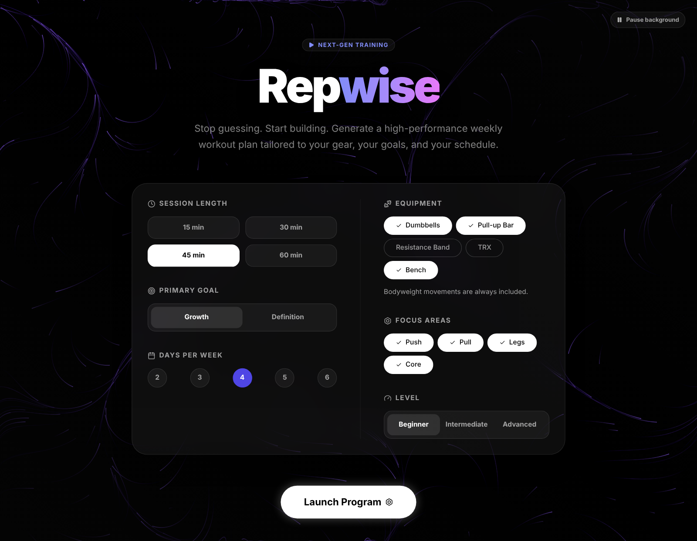
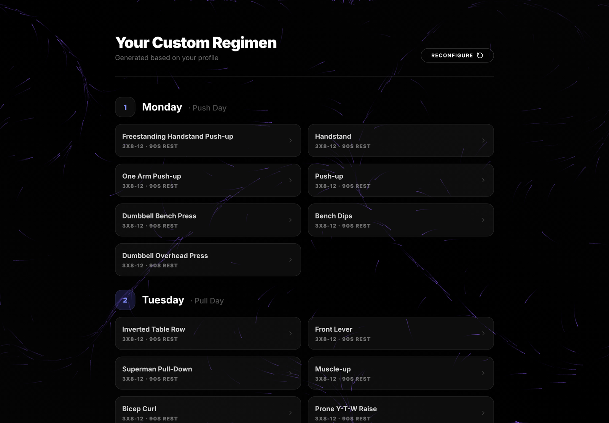
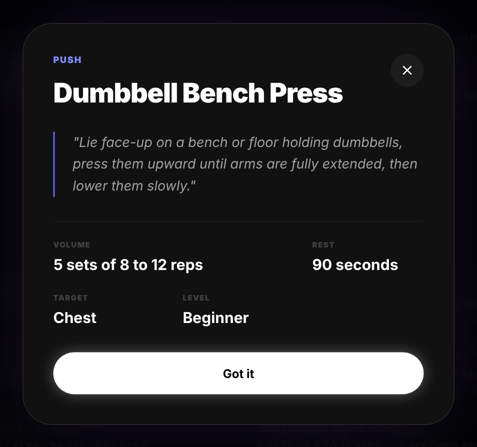

# Repwise

[](https://github.com/TheMambi/repwise/actions/workflows/security.yml)
[](LICENSE)

A weekly home workout planner. Tell it what gear you own, your level, how long you can train and which areas you want to work, and it lays out a full week of sessions with sets, reps and rest for each movement.

**[Open the app](https://repwiseapp.vercel.app)**

[](https://repwiseapp.vercel.app)

It mixes calisthenics and weight work, keeps each session inside your time budget, and spreads training days so rest falls between them. Every day shows how long it should take, and a day that comes out shorter than you asked for says so. Tap any exercise for form notes.

Everything runs in your browser. There is no backend, no account, no analytics, and nothing you pick is stored or sent anywhere.

## What it does

| Setting | Choices |
| --- | --- |
| **Session length** | 15, 30, 45 or 60 minutes |
| **Goal** | Growth (3 sets of 8 to 12 reps, 90 seconds rest) or definition (4 sets of 15 to 20 reps, 45 seconds rest). Holds such as the plank are timed instead: 20 to 30 seconds for growth, 30 to 45 for definition |
| **Level** | Beginner, intermediate or advanced. A plan only uses movements at or below your level |
| **Days per week** | 2 to 6, spaced so rest days land between sessions where the week allows |
| **Equipment** | Dumbbells, pull-up bar, resistance band, TRX, bench. Bodyweight movements are always included |
| **Focus areas** | Push, pull, legs, core |

The result is a day-by-day plan drawn from a catalog of 36 movements. Each exercise opens a detail card with how to do it, the volume, the rest, the target muscle and the level.

| A generated week | Exercise detail |
| :---: | :---: |
|  |  |

## How it works

The planner lives in [`src/lib/planner.ts`](src/lib/planner.ts) as one pure function, so the tests can run it with a fixed random source.

- **Equipment filter.** Each focus area gets a pool of the movements your gear allows. A movement that needs two things, such as a band and a pull-up bar, is only offered when you own both. Bodyweight work is always in the pool, so every area has something to do even with no equipment.
- **Spreading the week.** Focus areas rotate across the training days. Every area you chose gets at least one day; if there are more days than areas, the rotation repeats.
- **Level filter.** Each pool keeps only the movements at or below the level you chose. If an area has nothing that easy for your gear, its easiest movements stand in so the day is never empty, and every exercise shows its level.
- **Fitting the time.** An exercise is timed from its own prescription: every set at the top of its range, 3 seconds a rep, plus the rest after each set. That comes to about 6 minutes for growth and 7 for definition, so a 30 minute session holds 4 exercises and a 60 minute one about 9 or 8. The exercises are dealt out one at a time between the areas trained that day, so an area that runs out of movements leaves its share to the others.
- **Short days.** A small pool can run out before the session is full. The planner then adds sets, up to 5 per exercise, for as long as a whole extra round fits. If there is still room for another exercise after that, the day is marked as shorter than the length you picked. The lasting fix for a short day is more movements in the catalog.
- **Variety.** Each pool is shuffled once per plan and read in order, so an area that comes back later in the week gets fresh movements before any repeat.

## Accessibility

The exercise card is a proper dialog with a labelled title: focus moves into it, Escape closes it and focus returns to the exercise you opened. Option buttons announce their selected state, everything works from the keyboard, and the animated background stops when the system asks for reduced motion.

## Tech

React 19, TypeScript, Vite 6, Tailwind CSS 3 and lucide-react. The background is a canvas flow field written for this app. Tests use Node's built-in test runner. Deployed as a static site on Vercel.

Design file: [Figma](https://www.figma.com/design/jAm3pPTMjnJMJoY95sDB3I)

## Run it locally

```bash
git clone https://github.com/TheMambi/repwise.git
cd repwise
npm install            # also installs the pre-commit secret scanner
npm run dev            # http://localhost:5173
npm test               # planner and secret-scanner tests
npm run lint
npm run build && npm run preview
npm run scan:secrets   # scan every tracked file for credential patterns
```

Node 22 or newer.

Before changing the catalog or the planner, read the [known pitfalls](docs/PITFALLS.md).

## Project layout

```
src/
  App.tsx                 planner UI
  lib/planner.ts          plan-building logic (pure, unit-tested)
  lib/plan-text.ts        wording for sets, holds and session length
  data/exercises.ts       exercise catalog (36 movements)
  data/options.ts         the choices the form offers, shared by the form, catalog, planner and tests
  components/ui/          glass cards, buttons, flow-field background
tests/                    planner and secret-scanner tests
docs/                     README screenshots, the GitHub social preview and the known-pitfalls log
legacy/                   original single-file prototype and planning notes
.githooks/                pre-commit secret scanner (installed by npm install)
.github/                  CI workflow and Dependabot config
vercel.json               security headers
```

## Security

The site sends a strict Content-Security-Policy with no inline scripts or styles, refuses to be framed and forces HTTPS. CI scans the full Git history for secrets, runs `npm audit`, lint, tests and a production build on every push, and actions are pinned to commit hashes. See [SECURITY.md](SECURITY.md) for the details and for how to report a problem privately.

## License

Copyright (C) 2026 The Mambí. This program is free software: you can redistribute it and/or modify it under the terms of the GNU Affero General Public License as published by the Free Software Foundation, either version 3 of the License, or (at your option) any later version. See `LICENSE` for the full text.
